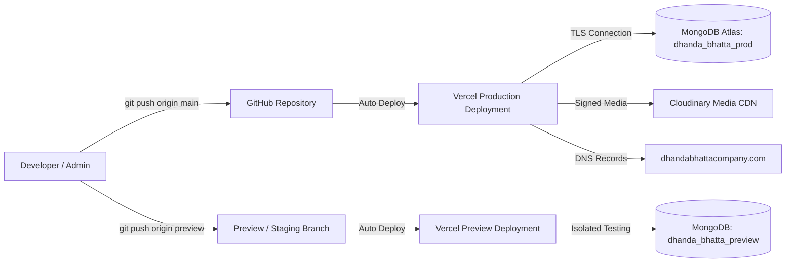

# Dhanda Bhatta Company — Production Deployment Guide

**Document Reference:** DBC-OPS-DEPLOY-V1  
**Project:** Dhanda Bhatta Company (Village Kalwa, Pillukhera, Jind, Haryana, India)  
**Target Platform:** Vercel + GitHub + MongoDB Atlas + Cloudinary  

---

## 1. Overview & Architecture

This guide provides step-by-step procedures to deploy the Dhanda Bhatta Company web application to **Vercel** with staging and production environments, automated GitHub CI/CD, and zero downtime.



---

## 2. GitHub Repository Setup

### Step 2.1: Initialize Git & Verify Ignore Rules
1. In the project root, ensure `.gitignore` excludes all secret files, `.env.local`, `.next`, `node_modules`, and backups:
   ```bash
   git status
   ```
2. Commit all application source files to the local repository:
   ```bash
   git add .
   git commit -m "feat(release): production-ready Dhanda Bhatta Company platform"
   ```

### Step 2.2: Create Remote Repository on GitHub
1. Sign in to GitHub and create a new **Private** repository named `dhanda-bhatta-company` (or `dbc`).
2. Add the remote and push the `main` branch:
   ```bash
   git remote add origin https://github.com/<username>/dhanda-bhatta-company.git
   git branch -M main
   git push -u origin main
   ```

### Step 2.3: Branch Protection Rules
In GitHub repository settings (`Settings > Branches`):
- Protect the `main` branch.
- Require pull request reviews before merging.
- Require status checks to pass before merging (`build`, `lint`).
- Prevent force pushes and branch deletions.

---

## 3. Vercel Project Setup

### Step 3.1: Import Project into Vercel
1. Log in to your [Vercel Dashboard](https://vercel.com).
2. Click **Add New... > Project**.
3. Import your GitHub repository (`dhanda-bhatta-company`).
4. In **Project Settings**:
   - **Framework Preset:** Next.js (automatically detected)
   - **Root Directory:** `./`
   - **Build Command:** `next build`
   - **Output Directory:** `.next`
   - **Install Command:** `npm install`

### Step 3.2: Function Region Configuration
To minimize database query latency between Vercel and MongoDB Atlas, ensure serverless functions run in the **Mumbai, India (`bom1`)** region.  
The project root includes `vercel.json`:
```json
{
  "$schema": "https://openapi.vercel.sh/vercel.json",
  "framework": "nextjs",
  "regions": ["bom1"]
}
```

---

## 4. Environment Variables Configuration

Configure environment variables in the Vercel Dashboard under **Settings > Environment Variables**. Never share or hardcode secrets in source code.

| Variable Name | Environment | Required | Description |
| :--- | :---: | :---: | :--- |
| `MONGODB_URI` | Production, Preview | **Yes** | MongoDB Atlas connection string (with TLS) |
| `MONGODB_DB_NAME` | Production, Preview | **Yes** | `dhanda_bhatta_prod` (prod) or `dhanda_bhatta_preview` (preview) |
| `BETTER_AUTH_SECRET` | Production, Preview | **Yes** | 32+ character high-entropy secret (`openssl rand -base64 32`) |
| `BETTER_AUTH_URL` | Production | **Yes** | Canonical URL e.g. `https://dhandabhattacompany.com` |
| `SITE_URL` | Production | **Yes** | Same as `BETTER_AUTH_URL` |
| `CLOUDINARY_CLOUD_NAME` | Production, Preview | Optional | Cloudinary account cloud name |
| `CLOUDINARY_API_KEY` | Production, Preview | Optional | Cloudinary API Key |
| `CLOUDINARY_API_SECRET` | Production, Preview | Optional | Cloudinary Server-only Secret |
| `RATE_LIMIT_SALT` | Production, Preview | Recommended | Random salt for hashing client IPs for privacy |
| `GOOGLE_SITE_VERIFICATION` | Production | Optional | Google Search Console verification meta tag |
| `NEXT_PUBLIC_GA_MEASUREMENT_ID` | Production | Optional | GA4 measurement ID (`G-XXXXXXXXXX`) |

> [!WARNING]
> Do NOT check the "Automatically expose System Environment Variables" for sensitive secrets. Keep `BETTER_AUTH_SECRET` and `CLOUDINARY_API_SECRET` strictly on the server side.

---

## 5. Preview Deployment & Staging Workflow

Before promoting any changes to the live production domain:

1. Create a feature or staging branch:
   ```bash
   git checkout -b preview
   ```
2. Commit updates and push to GitHub:
   ```bash
   git push origin preview
   ```
3. Vercel will automatically generate a Preview Deployment with a unique URL (e.g., `https://dbc-preview-git-preview-owner.vercel.app`).
4. **Testing in Preview:**
   - Verify public pages (Homepage, About, Products, Delivery, Contact).
   - Test enquiry and order request form submissions.
   - Test administrative login at `/admin/login` and verify 2FA prompt.
   - Verify that preview submissions write to the isolated preview database and NEVER touch production data.

---

## 6. Custom Domain & DNS Configuration

When the domain name (e.g., `dhandabhattacompany.com` or `dhandabhatta.in`) is ready:

### Step 6.1: Add Domain to Vercel
1. In Vercel, go to **Settings > Domains**.
2. Enter the domain name: `dhandabhattacompany.com`.
3. Choose the recommended option: Redirect `www.dhandabhattacompany.com` to `dhandabhattacompany.com` (or vice versa).

### Step 6.2: Configure DNS Records at Domain Registrar
Access your DNS provider (GoDaddy, Namecheap, Cloudflare, Google Domains):

| Type | Name / Host | Value / Target | TTL |
| :---: | :---: | :---: | :---: |
| **A** | `@` (root) | `76.76.21.21` (Vercel IP) | Automatic / 300 |
| **CNAME** | `www` | `cname.vercel-dns.com.` | Automatic / 300 |

> [!CAUTION]
> **Email DNS Integrity:** Do not delete or overwrite existing MX, SPF, DKIM, or DMARC records. Only update the root `@` A record and the `www` CNAME record.

### Step 6.3: SSL & HTTPS Verification
- Vercel will automatically generate and renew a free Let's Encrypt SSL/TLS certificate.
- Once DNS propagates (typically 5 to 30 minutes), verify that `https://dhandabhattacompany.com` loads with a valid padlock icon.

### Step 6.4: Update Canonical Environment Variables
After the custom domain is active, update the following variables in Vercel and trigger a redeployment:
- `SITE_URL` = `https://dhandabhattacompany.com`
- `BETTER_AUTH_URL` = `https://dhandabhattacompany.com`

---

## 7. Rollback & Disaster Recovery

If an issue occurs after a production deployment:

1. Go to your **Vercel Dashboard > Deployments**.
2. Locate the previous stable deployment.
3. Click the three dots `...` next to the deployment and select **Instant Rollback**.
4. Vercel will redirect all production traffic to the previous deployment within seconds without rebuilding.
