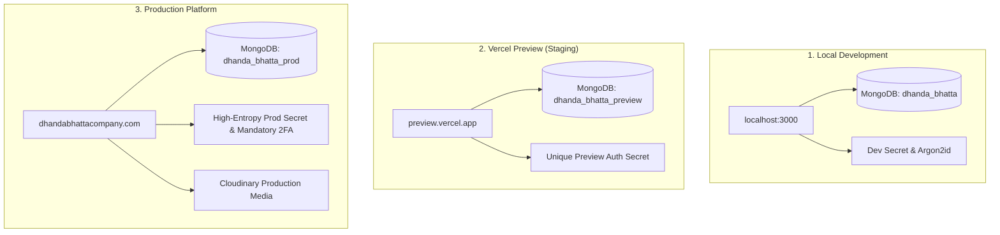

# Dhanda Bhatta Company — Production Environment & Infrastructure Architecture

**Document Reference:** DBC-OPS-ENV-V1  
**Project:** Dhanda Bhatta Company (Village Kalwa, Pillukhera, Jind, Haryana, India)  
**Security Classification:** Confidential — Architecture & Operations  

---

## 1. Environment Separation Architecture

To guarantee that untested code, preview experiments, and development tests never corrupt or leak live customer data, the application enforces strict separation across three tiers:



| Dimension | Local Development | Vercel Preview | Production |
| :--- | :--- | :--- | :--- |
| **Target URL** | `http://localhost:3000` | `https://*.vercel.app` | `https://dhandabhattacompany.com` |
| **Database** | `dhanda_bhatta` | `dhanda_bhatta_preview` | `dhanda_bhatta_prod` |
| **Auth Secret** | Dev string / `.env.local` | Unique 32-char secret | Unique 32-char production secret |
| **Public Registration** | Disabled | Disabled | Disabled |
| **2FA Requirement** | Enforced | Enforced | Enforced |
| **Rate Limiter** | In-Memory (sliding window) | In-Memory | In-Memory / Upstash Redis |
| **Customer Data** | Mock / developer tests | Staging validation | **Live Customer Inquiries Only** |

---

## 2. MongoDB Atlas Production Setup

### 2.1 Cluster Sizing & Region
- **Provider & Region:** AWS **`ap-south-1` (Mumbai, India)** to minimize latency to Vercel's `bom1` edge region and local Haryana users.
- **Tier:** M0 (Free Tier for launch) or M10+ (for automated point-in-time recovery and dedicated CPU/RAM).
- **Cluster Name:** `dbc-production-cluster`.

### 2.2 Database Isolation & Name
- Production database name must be explicitly set to: **`dhanda_bhatta_prod`**.
- Do not use the default `test` database or share the database with preview environments.

### 2.3 Least-Privilege Application User
Never use the Atlas Project Owner or administrative account for the web application.
1. In Atlas, go to **Database Access > Add New Database User**.
2. **Authentication Method:** Password (SCRAM-SHA-256).
3. **Username:** `dbc_app_user_prod`.
4. **Password:** Generate a 32-character random string (e.g. `openssl rand -base64 24`).
5. **Database User Privileges:** Select **Built-in Role > Read and write to any database** or click **Add Specific Privileges**:
   - Database: `dhanda_bhatta_prod`
   - Collection: *(leave blank for all collections)*
   - Role: `readWrite`

### 2.4 Network Access & Vercel Outbound IP Strategy

> [!IMPORTANT]
> **Understanding Serverless Egress Networking:**
> Vercel Serverless Functions execute on multi-tenant AWS compute nodes whose public egress IP addresses change dynamically as functions scale.

#### Architectural Options for MongoDB Atlas Network Access:

| Option | Architecture | Feasibility / Plan | Security Trade-off |
| :--- | :--- | :--- | :--- |
| **Option A: Static Egress NAT via Vercel Secure Compute** | Dedicated VPC peering / fixed static egress IPs | Requires Vercel Enterprise plan | Maximum perimeter security; exact IP allowlist in Atlas. |
| **Option B: Official Vercel MongoDB Atlas Integration** | Managed connection via Vercel Marketplace | Available on Hobby & Pro | Streamlined setup; connection string managed by Vercel integration. |
| **Option C: Strong Authentication + TLS over Dynamic Egress (`0.0.0.0/0`)** | Allow connections from any IP with SCRAM-SHA-256 + TLS 1.3 | Standard on Hobby & Pro | Requires strict defense-in-depth: strong unique credentials, non-admin user, encrypted env vars. |

#### If Option C is selected (Standard Vercel Deployment):
1. In Atlas, go to **Network Access > Add IP Address**.
2. Select **Allow Access From Anywhere** (`0.0.0.0/0`).
3. Set an **Expiration Date** if temporary, or label it `Vercel Serverless Production Egress`.
4. **Required Compensating Security Controls:**
   - Dedicated `dbc_app_user_prod` account scoped strictly to `dhanda_bhatta_prod` (no cluster admin rights).
   - Mandatory TLS 1.3 encryption on connection string (`mongodb+srv://...`).
   - Connection credentials stored solely in Vercel's encrypted server-side environment variables.
   - Zero exposure of `MONGODB_URI` in client bundles.

### 2.5 Initializing Production Database
Run the idempotent production initialization script locally before promoting to live traffic:
```bash
MONGODB_URI="mongodb+srv://dbc_app_user_prod:<password>@cluster0.mongodb.net/dhanda_bhatta_prod?retryWrites=true&w=majority" \
MONGODB_DB_NAME="dhanda_bhatta_prod" \
npm run db:init:prod
```
This ensures all indexes, initial site settings, and catalogue products exist without creating test customer submissions.

---

## 3. Database Backup & Disaster Recovery

### 3.1 MongoDB Atlas Automated Backups
- If using an Atlas paid tier (M10+), enable **Continuous Cloud Backups** (point-in-time recovery with 1-minute granularity and 7-day retention).
- For M0 / Free Tier clusters, schedule daily snapshot backups using `mongodump`.

### 3.2 Manual Backup Procedure (`mongodump`)
Execute before any major version upgrade or migration:
```bash
mongodump --uri="mongodb+srv://dbc_app_user_prod:<password>@cluster0.mongodb.net/dhanda_bhatta_prod" \
  --out="./backups/dbc_prod_backup_$(date +%Y%m%d_%H%M%S)" \
  --gzip
```

### 3.3 Restoration Procedure (`mongorestore`)
In the event of accidental data corruption or disaster recovery:
```bash
mongorestore --uri="mongodb+srv://dbc_app_user_prod:<password>@cluster0.mongodb.net/dhanda_bhatta_prod" \
  --drop \
  --dir="./backups/dbc_prod_backup_<timestamp>/dhanda_bhatta_prod" \
  --gzip
```

> [!CAUTION]
> The `--drop` flag will replace existing collections with the backup data. Never run `mongorestore` without verifying the backup timestamp and contents first.

---

## 4. Cloudinary Production Setup

### 4.1 Production Account & Cloud Name
- Register a dedicated production Cloudinary cloud or environment (e.g., `dhanda-bhatta-prod`).
- Ensure default folder structure is organized under `dhanda_bhatta/facility/` and `dhanda_bhatta/products/`.

### 4.2 Security Constraints
- **Signed Administrative Uploads:** The application utilizes server-side signed uploads via `/api/admin/cloudinary/sign`. Anonymous unauthenticated uploads are strictly blocked.
- **Allowed Formats:** Images: JPEG, PNG, WebP (Max 10MB). Videos: MP4, WebM (Max 100MB).
- **Client Security:** Never expose `CLOUDINARY_API_SECRET` to client-side JavaScript or public environment variables. Only `CLOUDINARY_CLOUD_NAME` and `CLOUDINARY_API_KEY` may be referenced where needed.

---

## 5. Better Auth Production Security

### 5.1 Secret Generation
Generate a cryptographically secure 256-bit random string for `BETTER_AUTH_SECRET`:
```bash
openssl rand -base64 32
```
Never reuse the development secret.

### 5.2 Mandatory 2FA Enforcement
- Public self-registration is strictly disabled (`disableSignUp: true`).
- Initial admin is provisioned via `npm run admin:create`.
- The application automatically detects unenrolled administrators and redirects them to `/admin/security/setup-2fa`.
- Single-use emergency backup recovery codes must be saved offline by the owner upon setup.

### 5.3 Trusted Origins
In production, Better Auth strictly validates request origins against:
```
[
  "https://dhandabhattacompany.com",
  "https://www.dhandabhattacompany.com"
]
```
Requests originating from unauthorized origins or development hosts are rejected.

---

## 6. Secret Rotation Procedures

If any production credential is compromised or routinely rotated:

1. **MongoDB User Password Rotation:**
   - In Atlas, create a temporary second user (`dbc_app_user_prod_v2`) with identical privileges.
   - Update `MONGODB_URI` in Vercel settings with the new user credentials.
   - Trigger a Vercel redeployment and verify database connectivity via `/api/health`.
   - Delete the old user from MongoDB Atlas.

2. **Better Auth Secret Rotation:**
   - Generate a new 32-character secret.
   - Update `BETTER_AUTH_SECRET` in Vercel.
   - Redeploy the application.
   - *Note:* Rotating `BETTER_AUTH_SECRET` immediately invalidates all active administrator sessions, requiring re-login with master password and TOTP code.

3. **Cloudinary Secret Rotation:**
   - In Cloudinary Console, generate a secondary API Secret.
   - Update `CLOUDINARY_API_SECRET` in Vercel.
   - Redeploy and verify media uploads.
   - Invalidate the primary secret in Cloudinary.
